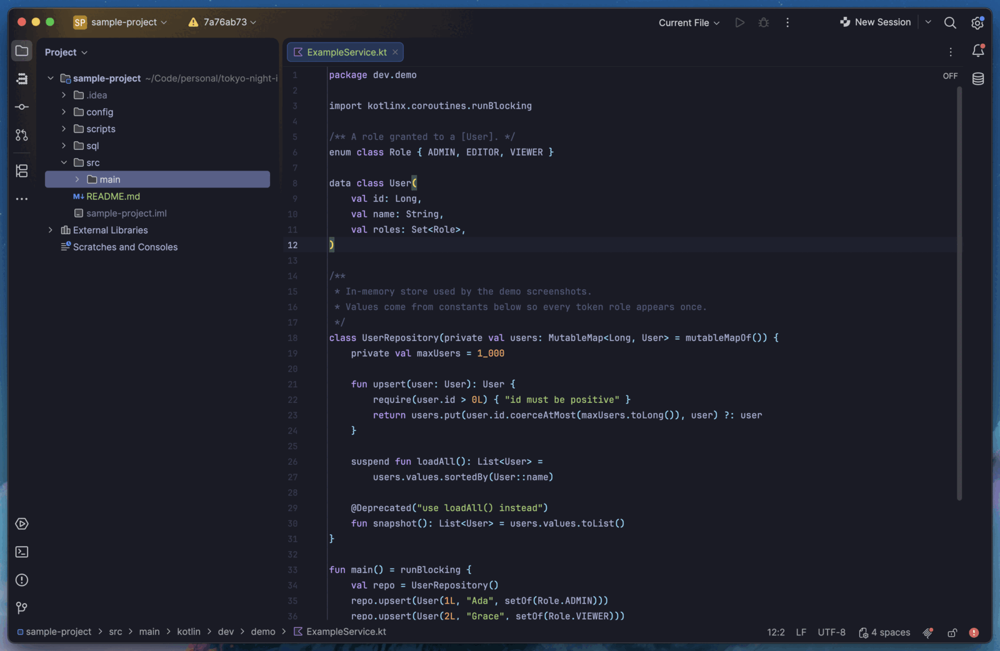
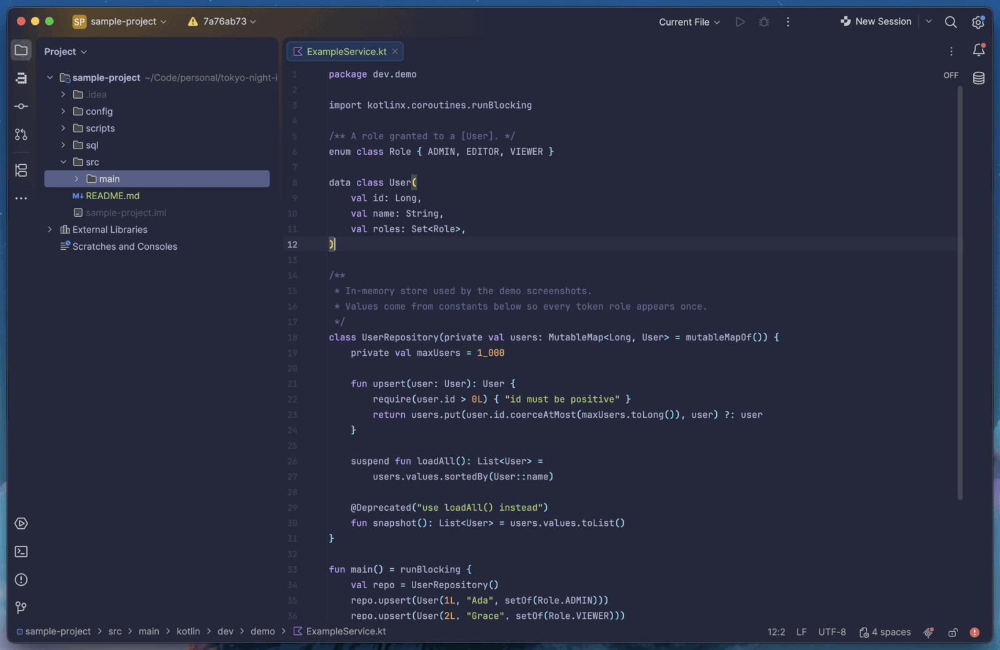
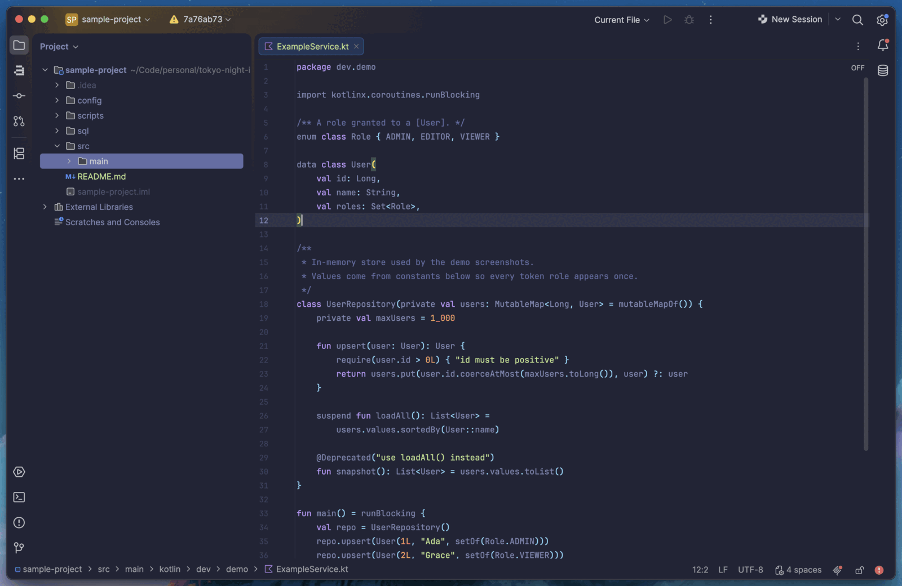
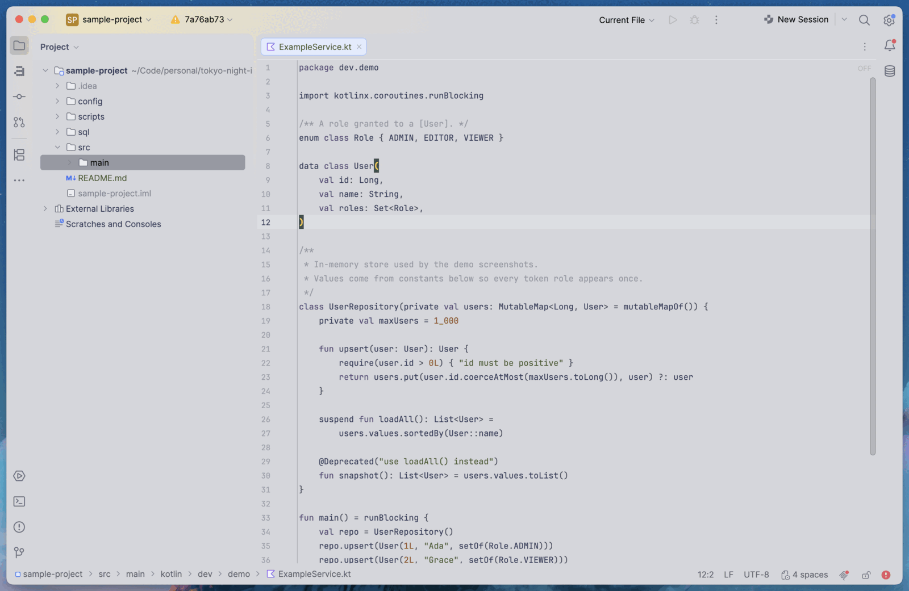

# Tokyo Night for IntelliJ IDEA

<div align="center">
  <a href="https://plugins.jetbrains.com/plugin/35030">
    
  </a>
</div>

A theme-only IntelliJ plugin that ports all four variants of the Zed theme
[`ssaunderss/zed-tokyo-night`](https://github.com/ssaunderss/zed-tokyo-night)
to IntelliJ IDEA: **Tokyo Night**, **Tokyo Night Storm**, **Tokyo Night Moon**,
and **Tokyo Night Light**.

Each variant ships UI chrome (`*.theme.json`), syntax highlighting plus terminal
and diff colors (`*.xml` editor scheme), so selecting a theme applies the editor
scheme automatically.

Target platform: **IntelliJ IDEA 2026.2+** (`sinceBuild = 262`, no `untilBuild`);
built and verified against the pinned **2026.3** EAP archive.

[](https://plugins.jetbrains.com/plugin/35030)



## Variants

| Theme | Appearance | Base background |
| --- | --- | --- |
| Tokyo Night | dark | `#1a1b26` |
| Tokyo Night Storm | dark | `#24283b` |
| Tokyo Night Moon | dark | `#222436` |
| Tokyo Night Light | light | `#d5d6db` |

## How it works

The upstream Zed palette JSON is the single source of truth. A stdlib-only
Python generator reads the pinned copy at `tools/vendor/tokyo-night.json` and
emits every resource file. **Generated outputs are committed**, so building the
plugin does not require Python.

```
tools/vendor/tokyo-night.json   pinned upstream palette (source of truth)
tools/generate.py               generator (stdlib only)
tools/mappings/*.py             Zed -> IntelliJ key mappings per subsystem
src/main/resources/themes/*     generated theme.json + xml (committed)
```

## Build

Tooling is driven by [mise](https://mise.jdx.dev):

```bash
mise install        # pin JDK 21, Python and uv
mise run build      # ./gradlew buildPlugin
mise run check      # generator drift check + buildPlugin (the pre-land gate)
```

Plain Gradle works too:

```bash
./gradlew buildPlugin   # artifact at build/distributions/
```

## Install from JetBrains Marketplace

Search for **Tokyo Night** under Settings > Plugins > Marketplace, or install from
the plugin page at <https://plugins.jetbrains.com/plugin/35030>.
Then choose a theme under Settings > Appearance & Behavior > Appearance.

Every version is also attached to a
[GitHub Release](https://github.com/Jarvvski/tokyo-night-intellij/releases) as a
signed zip.

## Install from disk

1. Settings > Plugins > (gear) > Install Plugin from Disk...
2. Select `build/distributions/tokyo-night-intellij-<version>.zip`.
3. Restart, then choose a theme under Settings > Appearance & Behavior > Appearance.

## Regenerate resources

After editing the generator or its mappings:

```bash
uv run tools/generate.py
```

Re-commit the changed files under `src/main/resources/themes/`. Never hand-edit
generated files - see [`CLAUDE.md`](CLAUDE.md).

## Releasing

Releases are cut by the **Release** GitHub Actions workflow
(`workflow_dispatch`): it reads the version from `gradle.properties`, runs
`mise run check`, verifies compatibility, signs the zip, creates the bare
`X.Y.Z` GitHub Release with the changelog as its notes, and publishes to the
JetBrains Marketplace default channel.

One-time setup:

1. Create a JetBrains account and vendor profile at
   <https://plugins.jetbrains.com>.
2. Generate a signing key and self-signed certificate chain. You create these
   yourself with `openssl`; JetBrains issues none of them:
   ```bash
   openssl genpkey -aes-256-cbc -algorithm RSA -out private_encrypted.pem -pkeyopt rsa_keygen_bits:4096
   openssl rsa -in private_encrypted.pem -out private.pem
   openssl req -key private.pem -new -x509 -days 3650 -out chain.crt -subj "/CN=Adam Jarvis"
   base64 -i private.pem | tr -d '\n' > private.b64
   base64 -i chain.crt | tr -d '\n' > chain.b64
   ```
   `PRIVATE_KEY_PASSWORD` is the passphrase you type at the first prompt. With
   the unencrypted `private.pem` produced above it is ignored, so any value works.
3. Add repository secrets (`gh secret set <NAME> -R Jarvvski/tokyo-night-intellij`):
   - `CERTIFICATE_CHAIN` = contents of `chain.b64`
   - `PRIVATE_KEY` = contents of `private.b64`
   - `PRIVATE_KEY_PASSWORD` = your passphrase (any value with the unencrypted key)
   - `PUBLISH_TOKEN` = token from <https://plugins.jetbrains.com/author/me/tokens>
4. Upload the first version manually through the Marketplace web UI (JetBrains
   requires the initial publication to be manual). Run the workflow once with
   `dry_run` enabled to produce a signed zip, then upload it from the GitHub
   Release.

After that, each release is just a version bump plus **Run workflow**. See
[`docs/adr/0005-distribute-via-marketplace-and-releases.md`](docs/adr/0005-distribute-via-marketplace-and-releases.md)
for the rationale.

## Screenshots

The default variant is shown at the top of this README. The other three:

<details>
<summary>Tokyo Night Storm</summary>



</details>

<details>
<summary>Tokyo Night Moon</summary>



</details>

<details>
<summary>Tokyo Night Light</summary>



</details>

Screenshots are captured from an isolated sandbox IDE - a separate copy of the
pinned EAP build, so your installed IDE and its settings are untouched - using
the throwaway sources in
[`screenshots/sample-project`](screenshots/sample-project):

```bash
mise run demo        # launches the sandbox with the sample project open, Tokyo Night preselected
```

Open a source file (for example `ExampleService.kt`), then capture a window
screenshot. Switch variant under Settings > Appearance & Behavior > Appearance and
repeat. Save the images as `screenshots/<variant>.png`.

## Contributing

Project conventions and agent guidance live in [`CLAUDE.md`](CLAUDE.md) and
[`AGENTS.md`](AGENTS.md). The plan of record is [`plan.md`](plan.md).

## License

MIT. See [`LICENSE`](LICENSE), which also records upstream attribution.
